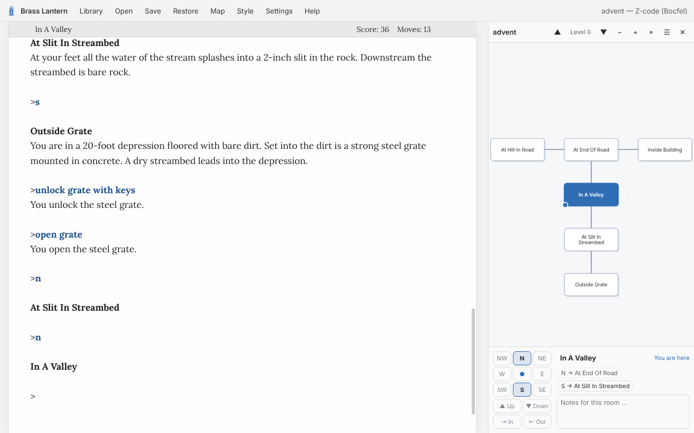
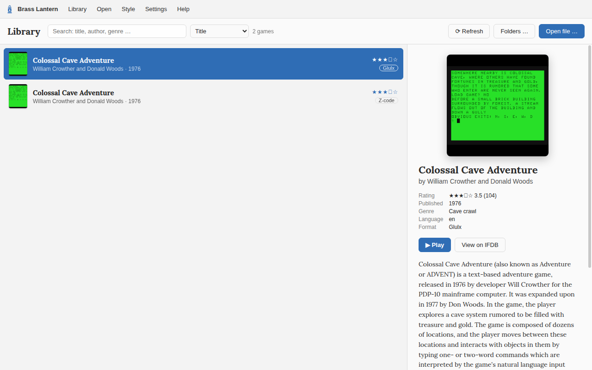
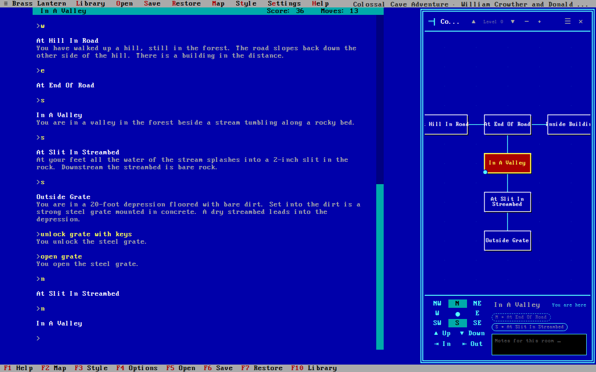
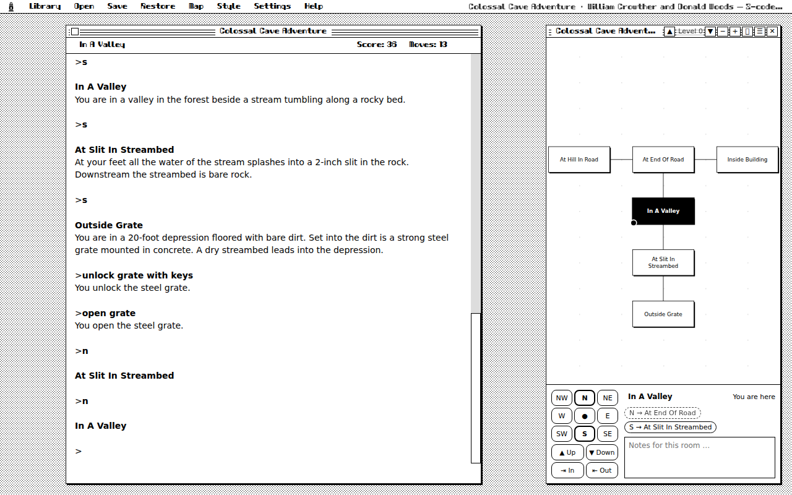
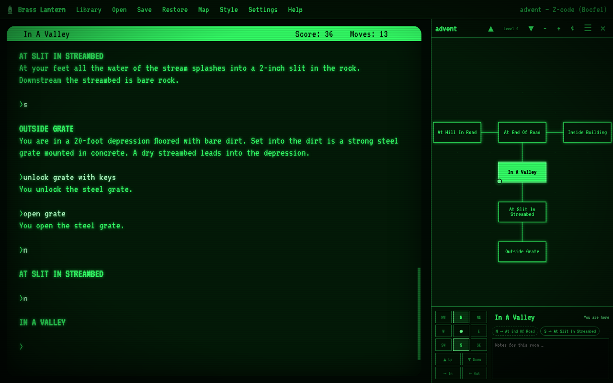
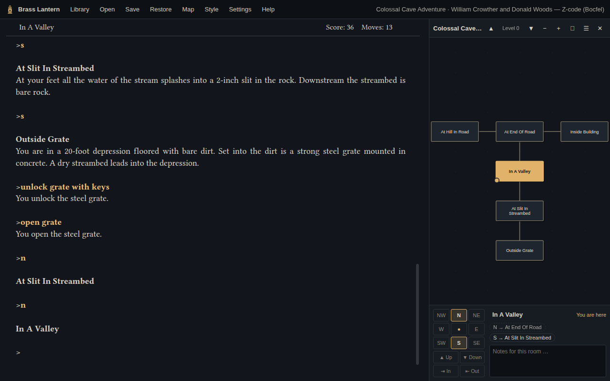
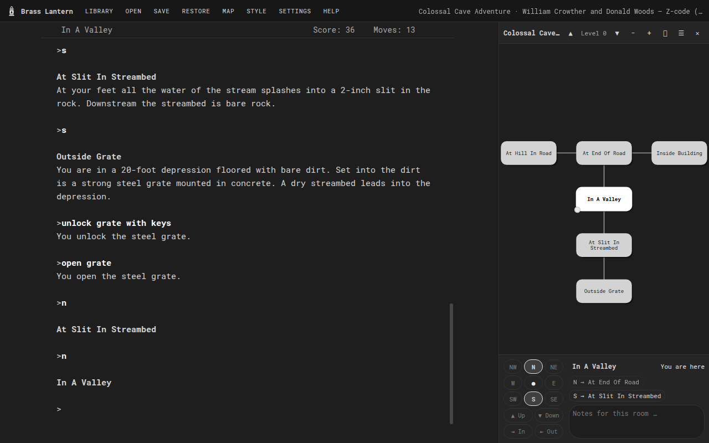
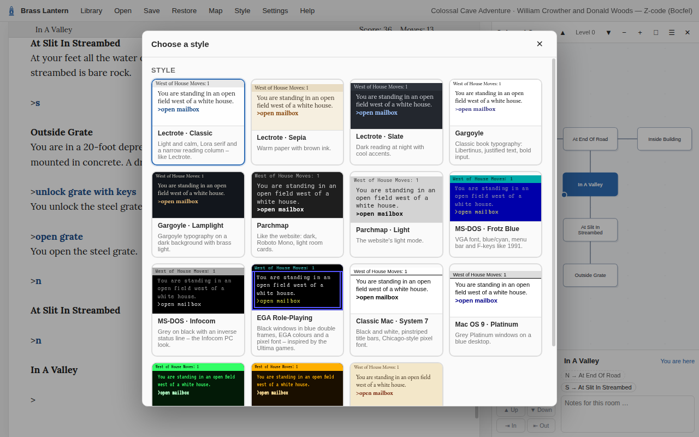

# Brass Lantern

**English** · [Deutsch](README.de.md)

An interactive fiction interpreter for **Windows, macOS and Linux** with an **automatic map** (inspired by [Parchmap](https://github.com/roylaza/parchmap)), a **game library synced with IFDB**, and a bunch of retro styles – from MS-DOS and the classic Mac to green phosphor terminals.



## Features

- **All the common formats:** Z-code (.z3–.z8, .zblorb, including Z6 via Bocfel), Glulx (.ulx, .gblorb – Glulxe or Git), TADS 2 and 3 (.gam, .t3), Hugo (.hex) and ADRIFT 4 (.taf). Pictures in Blorb files are displayed.
- **Automap:** rooms are detected from the status line and bold room headings, and connected as you move (English and German direction words). Up/down switch levels, in/out are drawn dashed. Double-click a room to walk there, drag rooms around, add notes, search the room list, export as SVG. The map can be hidden (Ctrl/⌘+M).
- **The map belongs to your saved game:** a new game starts with an empty map, `save` stores the map with the save file and `restore` brings back exactly that map – no spoilers from your furthest playthrough. Room notes survive across saves.
- **Library:** pick one or more game folders; Brass Lantern lists every story with cover art, author, year, format and rating, and shows description, genre, play time and tags in a side panel. Data comes from the [Interactive Fiction Database](https://ifdb.org) (matched by IFID, falling back to the title; you can choose the right entry by hand). Sync can be turned off.
- **Local files:** open any story via dialog, drag & drop, “Open with …” or the command line.
- **Comfort:** command history, Tab completion from the game text, `/goto room`, `/note text`, save/restore buttons in the top bar, transcripts.
- **14 styles:** Lectrote (Classic, Sepia, Slate), Gargoyle (light, lamplight), Parchmap (dark, light), MS-DOS (Frotz blue, Infocom black – VGA font and F-key bar), Classic Mac System 7, Mac OS 9 Platinum, green and amber phosphor (CRT), parchment. Typeface, size, line spacing, text width and a CRT effect can be set for any style.
- **Interface language:** English (default) or German.

| | |
|---|---|
|  |  |
|  |  |
|  |  |
|  | |

## Download & install

Grab the files from the [releases page](https://github.com/Schnubbirunkel/brass-lantern/releases/latest).

- **Windows:** `BrassLantern-Setup-<version>.exe` (installs per user, no admin rights) or the portable `…-win.zip`. The installer isn't signed, so SmartScreen may warn you: “More info” → “Run anyway”.
- **macOS:** `…-mac-arm64.zip` for Apple Silicon, `…-mac-intel.zip` for Intel. The app isn't notarised; after moving it to Applications run once:
  ```sh
  xattr -cr "/Applications/Brass Lantern.app"
  ```
- **Linux:** the `.AppImage` (`chmod +x` and run) or the `.deb` (`sudo apt install ./brass-lantern_<version>_amd64.deb`).

## Building from source

Requires Node.js 22 or newer.

```sh
npm install
npm start            # run from source
npm run dist:linux   # AppImage + .deb
npm run dist:mac     # macOS zips (on a Mac they get ad-hoc signed)
npm run dist:win     # Windows zip + NSIS installer (works on Linux/macOS too)
```

GitHub Actions (`.github/workflows/build.yml`) tests and builds every push for all platforms and takes the screenshots in `docs/screenshots` (German and English). The version lives in the file `VERSION`; when a push to `main` carries a version without a release, the release `v<VERSION>` is published automatically with all builds and screenshots (notes from `docs/release-notes/v<VERSION>.md`).

```sh
npm test             # tests with the stories in test/fixtures (needs xvfb-run)
npm run screenshots  # regenerate docs/screenshots
```

## How it's built

- `src/main/` – Electron main process, format detection and IFIDs, game library and IFDB client, engine host (every story runs in its own utility process)
- `src/renderer/js/glkote.js` – a GlkOte-protocol display (buffer, grid and graphics windows, input, styles)
- `src/renderer/js/automap.js`, `mapview.js` – room detection, map graph and SVG map
- `src/renderer/css/themes.css` – all styles
- `src/shared/en.json` – English interface strings (German is the source language)
- `tools/bitmap2ttf.py` – builds the VGA and Chicago-like pixel fonts from bitmap fonts

## Licences

The interpreters come from [emglken](https://github.com/curiousdannii/emglken): Bocfel, Glulxe, Git and Hugo are MIT/BSD-licensed, TADS and SCARE are GPL-2.0, so Brass Lantern as a whole is GPL-3.0-or-later. Fonts from Fontsource (SIL OFL). The pixel fonts are based on the bitmap fonts in VileR's [vga-text-mode-fonts](https://github.com/viler-int10h/vga-text-mode-fonts). Screenshots show *Adventure* (Crowther & Woods, Inform port by Graham Nelson) and *Bronze* by Emily Short.
