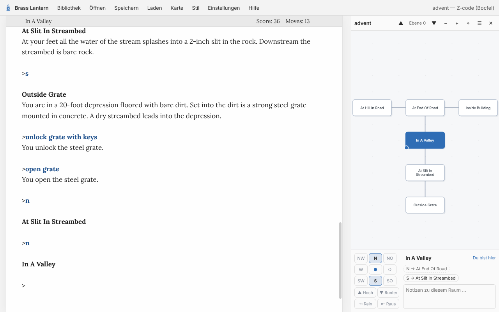
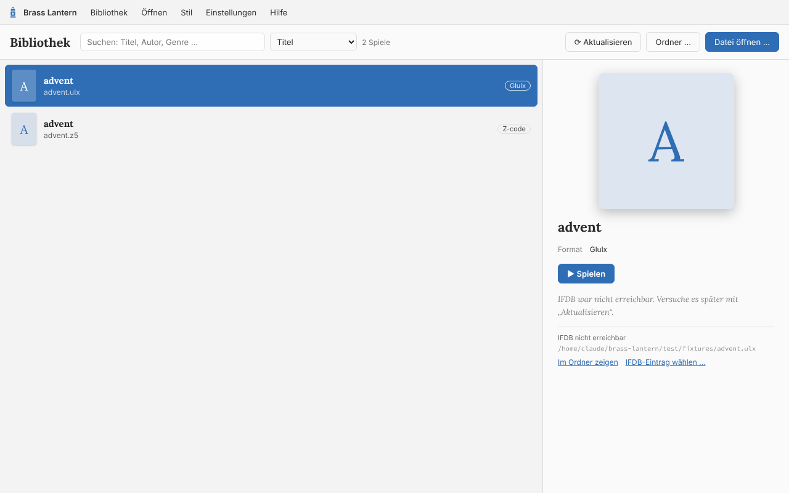

## Brass Lantern 1.2.3 – Releases wie bei den anderen Projekten

**Deutsch**
- **Automatische Releases:** Jede neue Version wird von GitHub Actions für Windows, macOS und Linux gebaut und mit allen Dateien veröffentlicht – die Versionsnummer steht jetzt in der Datei `VERSION`.
- **Screenshots in jedem Release:** Die Bilder werden bei jedem Build automatisch auf Deutsch und Englisch erzeugt, liegen in `docs/screenshots` und hängen als `de_*.png` und `screenshots.zip` am Release.
- **Automatische Tests bei jedem Push:** Spielstart, Speichern/Laden, Karte am Spielstand, Statusleiste beim Größenändern und Windows-Pfade.
- **macOS:** Die App wird auf einem Mac gebaut und signiert – nach dem Entpacken genügt einmal `xattr -cr "/Applications/Brass Lantern.app"`.

**English**
- Every new version is built for Windows, macOS and Linux by GitHub Actions and released automatically · screenshots in German and English are generated on every build and attached to the release · automated tests on every push (starting stories, save/restore, map tied to saves, status bar resizing, Windows paths) · the macOS app is built and signed on a Mac – after unzipping run `xattr -cr "/Applications/Brass Lantern.app"` once.

| System | Datei / File |
|---|---|
| Windows | `BrassLantern-Setup-1.2.3.exe` · `BrassLantern-1.2.3-win-x64-portable.zip` |
| macOS | `BrassLantern-1.2.3-mac-arm64.zip` (Apple Silicon) · `BrassLantern-1.2.3-mac-intel.zip` |
| Linux | `BrassLantern-1.2.3-linux-x64.AppImage` · `brass-lantern_1.2.3_amd64.deb` |

Windows SmartScreen: „Weitere Informationen“ → „Trotzdem ausführen“ / “More info” → “Run anyway”.

