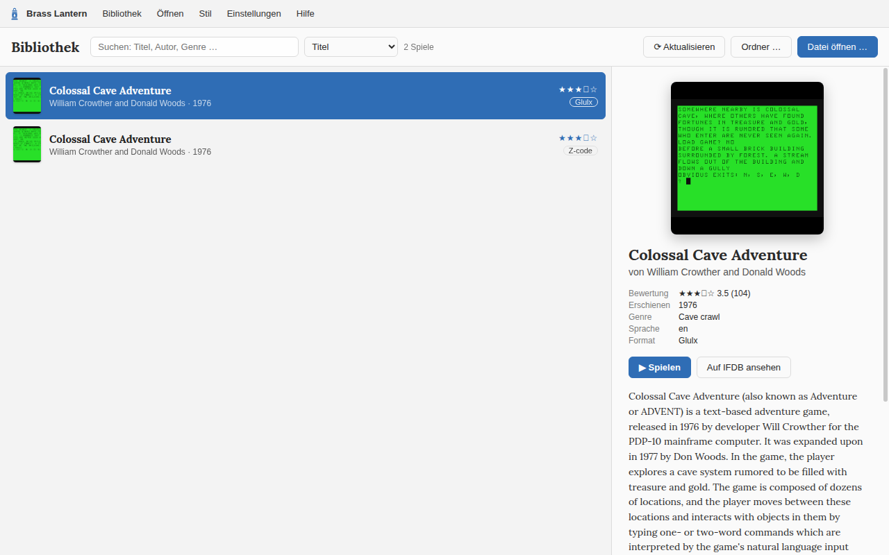
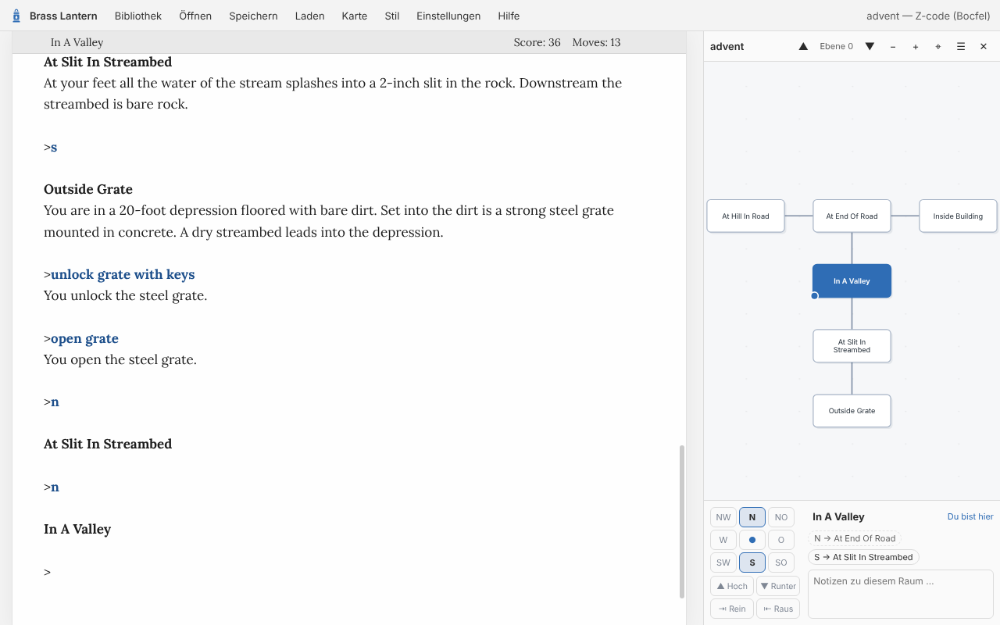

## Brass Lantern 1.2.4 – Halbe Sterne

**Deutsch**
- **Bewertungen in der Bibliothek:** Der halbe Stern (z. B. bei 3,5 von 5) wurde auf manchen Systemen als leeres Kästchen angezeigt, weil das Zeichen in vielen Schriften fehlt. Er wird jetzt selbst gezeichnet und sieht überall gleich aus.

**English**
- The half star in IFDB ratings (e.g. 3.5 of 5) showed up as an empty box on some systems because the character is missing in many fonts – it is now drawn by the app and looks the same everywhere.

| System | Datei / File |
|---|---|
| Windows | `BrassLantern-Setup-1.2.4.exe` · `BrassLantern-1.2.4-win-x64-portable.zip` |
| macOS | `BrassLantern-1.2.4-mac-arm64.zip` (Apple Silicon) · `BrassLantern-1.2.4-mac-intel.zip` |
| Linux | `BrassLantern-1.2.4-linux-x64.AppImage` · `brass-lantern_1.2.4_amd64.deb` |

Windows SmartScreen: „Weitere Informationen“ → „Trotzdem ausführen“ / “More info” → “Run anyway”. macOS: `xattr -cr "/Applications/Brass Lantern.app"` einmal ausführen / run once.

