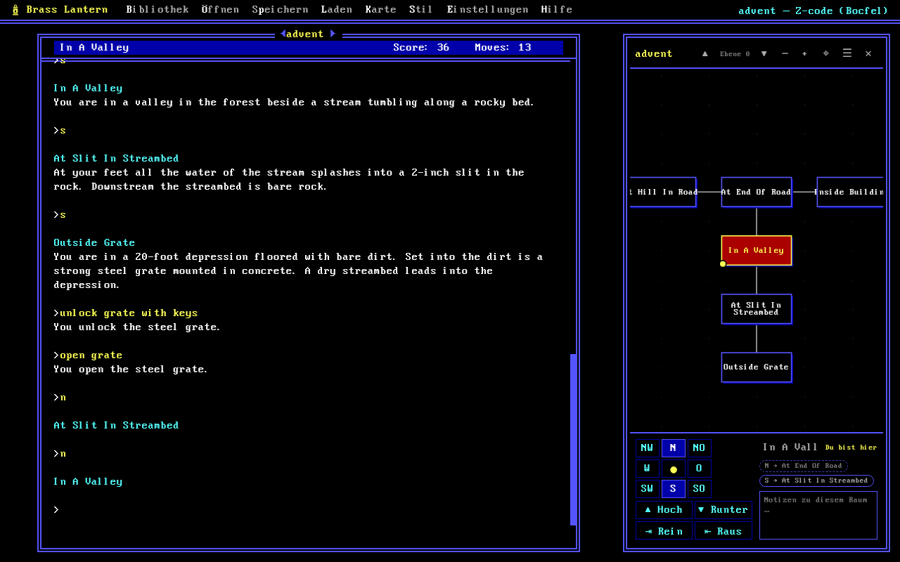
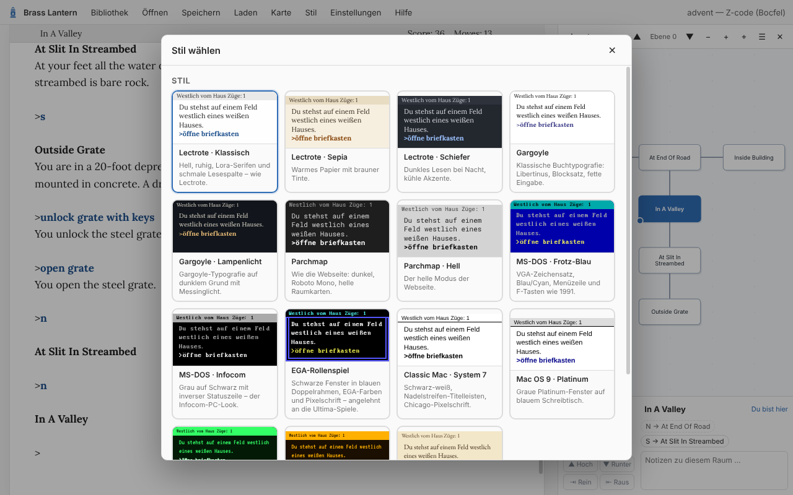

## Brass Lantern 1.3.0 – EGA-Rollenspiel

**Deutsch**
- **Neuer Stil „EGA-Rollenspiel“:** angelehnt an die Ultima-Spiele der 80er. Schwarze Fenster in blauen Doppelrahmen mit Nieten an den Ecken, der Spieltitel sitzt als Plakette auf dem Rahmen, die Karte steht in einem eigenen gerahmten Seitenfenster. Text in der 16-Farben-EGA-Palette (Eingaben gelb, Raumnamen und Hervorhebungen cyan, aktueller Raum rot) und in der VGA-Pixelschrift. Auch Bibliothek, Dialoge und Stil-Auswahl tragen den Rahmen.
- Auswahl über **Stil** in der Menüleiste.

**English**
- **New “EGA Role-Playing” style:** inspired by the Ultima games of the 80s. Black windows in blue double frames with rivets at the corners, the game title sits as a plate on the frame, and the map lives in its own framed side window. Text uses the 16-colour EGA palette (input yellow, room names and emphasis cyan, current room red) and the VGA pixel font. The library, dialogs and the style picker get the frame too.
- Pick it via **Style** in the menu bar.

| System | Datei / File |
|---|---|
| Windows | `BrassLantern-Setup-1.3.0.exe` · `BrassLantern-1.3.0-win-x64-portable.zip` |
| macOS | `BrassLantern-1.3.0-mac-arm64.zip` (Apple Silicon) · `BrassLantern-1.3.0-mac-intel.zip` |
| Linux | `BrassLantern-1.3.0-linux-x64.AppImage` · `brass-lantern_1.3.0_amd64.deb` |

Windows SmartScreen: „Weitere Informationen“ → „Trotzdem ausführen“ / “More info” → “Run anyway”. macOS: `xattr -cr "/Applications/Brass Lantern.app"` einmal ausführen / run once.

